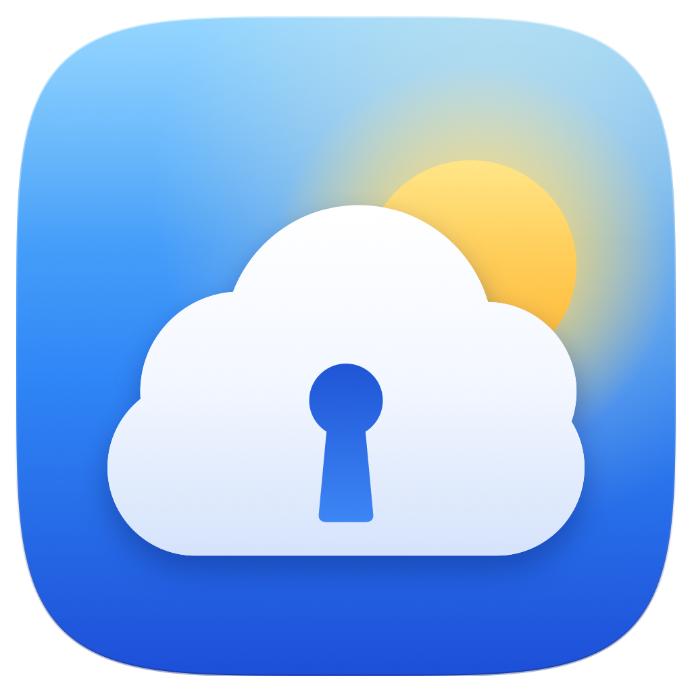

<p align="center">
  
</p>

<h1 align="center">Skykeep</h1>

<p align="center"><strong>Six apps. Your whole iCloud.</strong><br>Notes, Reminders, Calendar, Contacts, iCloud Drive and Photos as native apps for Windows and Linux. Fast, light, and offline.</p>

<p align="center">
  <a href="https://github.com/YashwanthKamireddi/Skykeep/releases/latest"><strong>Download</strong></a> ·
  <a href="#install">Install</a> ·
  <a href="#engineering">How it works</a> ·
  <a href="#private-by-design">Privacy</a> ·
  <a href=".github/CONTRIBUTING.md">Contribute</a>
</p>

<p align="center">
  <a href="ARCHITECTURE.md"></a>
  <a href="#install"></a>
  <a href="https://github.com/YashwanthKamireddi/Skykeep/releases"></a>
  <a href="https://github.com/YashwanthKamireddi/Skykeep/actions/workflows/ci.yml"></a>
  <a href="https://github.com/YashwanthKamireddi/Skykeep/releases/latest"></a>
  <a href="LICENSE"></a>
</p>

<p align="center"><a href="https://apps.microsoft.com/detail/9P6B042JNK54"></a>&nbsp;&nbsp;<a href="https://snapcraft.io/skykeep"></a></p>

Skykeep keeps your iCloud on your own computer and syncs it quietly in the background. Every app opens instantly, works with no connection at all, and stays in step with your iPhone, iPad and Mac as you use them. Underneath is a small Rust engine that idles at under 0.1% of a CPU core.

<p align="center"></p>

## This fork: Skykeep for Mac, and a new look

This is a fork of [Skykeep](https://github.com/YashwanthKamireddi/Skykeep) by Yashwanth Kamireddi, maintained by **Matheus Faria** ([@matthfaria96](https://github.com/matthfaria96)), focused on usability. It adds:

- **Skykeep for Mac** ([`macos/`](macos/README.md)) — a native SwiftUI app that puts Mail, Contacts, Reminders, Calendar, Notes, Photos, iCloud Drive and Passwords in one window, with a home screen that previews all of them. Notes and Mail are read and written online in iCloud through the same Rust code this repository uses on Windows and Linux (checklists tick, notes are edited in place, mail is sent and filed), so no other app is ever opened. It also connects Chromium browsers such as Vivaldi to Apple's Passwords app.
- **A new icon** — a cloud kept by a keyhole, under a rising sun — for macOS, Windows and Linux alike.

The Windows and Linux apps are otherwise the same as upstream, kept up to date with it.

## Your iCloud, as apps

<table>
  <tr>
    <td width="33%" align="center" valign="top"><picture><source media="(prefers-color-scheme: dark)" srcset="docs/media/notes-dark.webp"></picture><br><b>Notes</b><br><sub>Checklists, tables, drawings, #tags. Edits from two devices merge.</sub></td>
    <td width="33%" align="center" valign="top"><picture><source media="(prefers-color-scheme: dark)" srcset="docs/media/reminders-dark.webp"></picture><br><b>Reminders</b><br><sub>Smart lists, subtasks, tags. Alerts with Complete and Snooze.</sub></td>
    <td width="33%" align="center" valign="top"><picture><source media="(prefers-color-scheme: dark)" srcset="docs/media/calendar-dark.webp"></picture><br><b>Calendar</b><br><sub>Day to year views, drag to edit, time zones, video-call Join.</sub></td>
  </tr>
  <tr>
    <td width="33%" align="center" valign="top"><picture><source media="(prefers-color-scheme: dark)" srcset="docs/media/contacts-dark.webp"></picture><br><b>Contacts</b><br><sub>Every field, photos, lists, duplicate merging, vCard and CSV import.</sub></td>
    <td width="33%" align="center" valign="top"><picture><source media="(prefers-color-scheme: dark)" srcset="docs/media/drive-dark.webp"></picture><br><b>iCloud Drive</b><br><sub>Previews, uploads, resumable downloads, and a real folder in File Explorer or Files.</sub></td>
    <td width="33%" align="center" valign="top"><picture><source media="(prefers-color-scheme: dark)" srcset="docs/media/photos-dark.webp"></picture><br><b>Photos</b><br><sub>Library by month, albums, Shared Library, Live Photos and videos.</sub></td>
  </tr>
</table>

## Engineering

Skykeep is a native engine written in Rust with a light Tauri window on top: one codebase for Linux and Windows, on x86 and ARM.

- Every screen reads a local SQLite library, never the network. Apps open instantly and keep working offline.
- Changes from your iPhone arrive over Apple's own push channel, as they happen.
- Edits go into an outbox: shown the moment you make them, sent in order, held while you're offline, and safe to send twice.
- Notes merge through Apple's own CRDT, so typing on two devices at once keeps both edits.
- Apple's sign-in, SRP with two-factor, is rebuilt in Rust. Your password is never sent.
- The network lock lives in the engine's DNS resolver: it cannot look up a host that isn't Apple's.
- The photo grid stays smooth through 50,000 photos, keeping only what's near the screen in memory.
- iCloud Drive and Photos are real folders in File Explorer, through Cloud Files, the system OneDrive is built on, with Free up space and Always keep on this device. On Linux they're folders in your file manager, through FUSE.
- Each release passes over 1,300 Rust tests and is installed and launched on Ubuntu, Debian, Mint, Fedora, openSUSE, Arch and Windows before it's published.

[ARCHITECTURE.md](ARCHITECTURE.md) has the full tour.

## Private by design

- No Skykeep servers, accounts, analytics or crash reports. Your iCloud goes between your computer and Apple only.
- Your password and session live in the system keyring, the saved connection is encrypted with AES-256-GCM, and your library sits in a folder only you can read.
- The app window can't reach the internet at all; its content policy allows only Skykeep's own engine.
- Every line is open source, and every release is built in public with checksums and signature-checked updates.

[SECURITY.md](SECURITY.md) shows the code behind each point.

## Install

### macOS — Skykeep for Mac

Requires macOS 26 or later (Apple silicon or Intel).

Pick one:

1. **Terminal, one line (recommended).** Paste this into Terminal:
   ```sh
   curl -fsSL https://witchmymac.com/install.sh | bash -s skykeep
   ```
   It downloads the latest release from GitHub, checks its SHA-256, installs Skykeep in Applications and opens it. There's no macOS warning, because files downloaded by `curl` don't get the "downloaded from the internet" mark. Run the same line again to update. The script is open: [install.sh](https://witchmymac.com/install.sh).
2. **Download the DMG** from [Releases](https://github.com/matthfaria96/Skykeep/releases/latest), drag Skykeep to Applications, then allow it once with:
   ```sh
   xattr -dr com.apple.quarantine "/Applications/Skykeep.app"
   ```
   It only removes the "downloaded from the internet" mark from that app.
3. **Download the DMG** and allow it in System Settings: open the app, click OK on the warning, then go to System Settings › Privacy & Security and click Open Anyway.

Then open Notes to sign in to iCloud once, and Mail to connect it with an app-specific password. Details in [macos/README.md](macos/README.md).

### Windows and Linux

| Platform | Installation |
|---|---|
| **Windows** | [Microsoft Store](https://apps.microsoft.com/detail/9P6B042JNK54), or the [installer](https://github.com/YashwanthKamireddi/Skykeep/releases/latest/download/Skykeep-windows-x64-setup.exe). Also `choco install skykeep` and [Scoop](https://github.com/YashwanthKamireddi/scoop-bucket) |
| **Linux stores** | [Snap Store](https://snapcraft.io/skykeep)<br>Fedora and Fedora Asahi: `sudo dnf copr enable yashonfed/skykeep && sudo dnf install skykeep`<br>Arch: `yay -S skykeep` |
| **Linux files** | [`.deb`](https://github.com/YashwanthKamireddi/Skykeep/releases/latest/download/Skykeep-linux-amd64.deb) ([ARM](https://github.com/YashwanthKamireddi/Skykeep/releases/latest/download/Skykeep-linux-arm64.deb)), [`.rpm`](https://github.com/YashwanthKamireddi/Skykeep/releases/latest/download/Skykeep-linux-x86_64.rpm) ([ARM](https://github.com/YashwanthKamireddi/Skykeep/releases/latest/download/Skykeep-linux-aarch64.rpm)), or the [AppImage](https://github.com/YashwanthKamireddi/Skykeep/releases/latest/download/Skykeep-linux-x86_64.AppImage) for any other Linux |

Every file, with checksums, is on the [latest release](https://github.com/YashwanthKamireddi/Skykeep/releases/latest). The Windows installer, the AppImage and every store keep Skykeep up to date; for a `.deb` or `.rpm`, install the new one over the old.

<details>
<summary>Commands for each Linux file, and fixes for Fedora, openSUSE and the AppImage</summary>

```sh
sudo apt install ./Skykeep-linux-amd64.deb                          # Ubuntu, Debian, Mint
sudo dnf install ./Skykeep-linux-x86_64.rpm                         # Fedora
sudo zypper install --allow-unsigned-rpm ./Skykeep-linux-x86_64.rpm # openSUSE Tumbleweed
chmod +x Skykeep-linux-x86_64.AppImage && ./Skykeep-linux-x86_64.AppImage
sudo snap install skykeep && sudo snap connect skykeep:password-manager-service
```

The Snap's second command lets it keep you signed in through your keyring. On Ubuntu the AppImage needs `libfuse2t64` once (`libfuse2` on 22.04). Fedora and openSUSE leave out the decoder for iPhone photos (HEIC) for patent reasons: on Fedora, enable RPM Fusion and `sudo dnf install libheif-freeworld`; on openSUSE, add Packman and install `libheif1`. For Drive and Photos as folders on Arch, also `sudo pacman -S fuse3`.
</details>

## Sign in

1. Open Skykeep and sign in with your Apple Account.
2. Approve the sign-in on your iPhone, iPad or Mac, as you would for icloud.com.
3. Your library arrives, and each app fills in as it lands. From then on everything opens from your computer.

Using Advanced Data Protection? Turn on **Access iCloud Data on the Web** first (iPhone: Settings, your name, iCloud). Calendar and Contacts then open right away, and Notes, Reminders, Photos and iCloud Drive sync once you approve Skykeep on your iPhone.

## Questions

<details>
<summary>Is Skykeep made by Apple?</summary>

No. It's an independent, open-source app that works with iCloud. Apple, iCloud and iPhone are trademarks of Apple Inc.
</details>

<details>
<summary>How is this different from iCloud for Windows?</summary>

iCloud for Windows brings Photos and iCloud Drive to File Explorer, and Calendar and Contacts through Outlook. Skykeep has Notes and Reminders too, all six as apps of their own, works offline, and runs on Linux as well.
</details>

<details>
<summary>Why does it need my Apple Account password?</summary>

Notes, Reminders, Drive and Photos open only to a full sign-in with two-factor, the same one icloud.com uses. Skykeep proves your password to Apple with SRP rather than sending it, and keeps it in your system keyring so it can sign back in by itself. Like any keyring entry, programs running as you can read it, and signing out erases it.
</details>

<details>
<summary>How do I send a diagnostics log?</summary>

Quit Skykeep and start it with `SKYKEEP_LOG=1 skykeep` (Windows PowerShell: `$env:SKYKEEP_LOG=1`, then `skykeep.exe`). It writes `diagnostics.log` in its data folder with the addresses it asked and Apple's answer codes, never passwords, tokens or anything from your library. Attach it to a [bug report](https://github.com/YashwanthKamireddi/Skykeep/issues/new?template=bug_report.yml).
</details>

## Contributing

Skykeep is made by [Yashwanth](https://github.com/YashwanthKamireddi). Skykeep for Mac and the new icon are by [Matheus Faria](https://github.com/matthfaria96), in this fork. Bug reports, packaging for your distro, design ideas and code are all welcome. [CONTRIBUTING.md](.github/CONTRIBUTING.md) has the setup and a map of the code, and [Discussions](https://github.com/YashwanthKamireddi/Skykeep/discussions) is the place for questions and ideas. Security problems go to a [private report](https://github.com/YashwanthKamireddi/Skykeep/security/advisories/new).

Copyright (C) 2026 Yashwanth Kamireddi; Skykeep for Mac, the new icon and other changes in this fork copyright (C) 2026 Matheus Faria. [GPL-3.0](LICENSE): if you share a copy or a changed version, keep this notice and the same licence. Not affiliated with or endorsed by Apple Inc.
