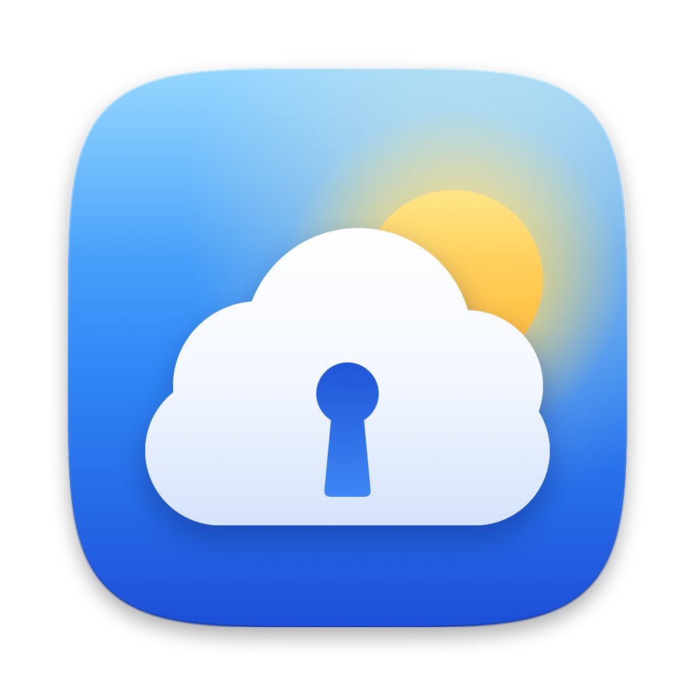
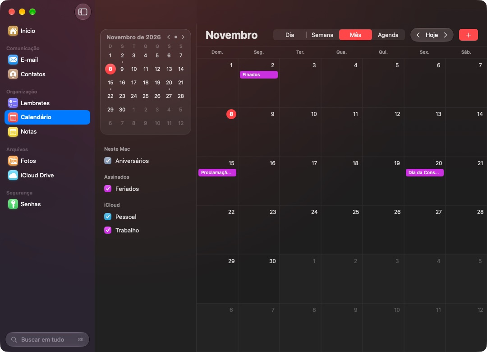

<p align="center">
  <a href="https://github.com/matthfaria96/Skykeep/releases/latest">
    
  </a>
</p>

<h1 align="center">Skykeep para Mac</h1>

<p align="center"><a href="README.md">English</a> · <b>Português</b></p>

<p align="center">
  <b>Todo o seu iCloud, numa janela só.</b><br>
  E-mail, Contatos, Lembretes, Calendário, Notas, Fotos, iCloud Drive e Senhas<br>
  num único app nativo, com uma tela de início que mostra o seu dia de relance.
</p>

<p align="center">
  
  
  
  
</p>

<p align="center">
  <a href="https://github.com/matthfaria96/Skykeep/releases/latest"><b>Baixar</b></a> ·
  <a href="#o-que-ele-faz">O que ele faz</a> ·
  <a href="#o-que-este-fork-acrescenta">O que este fork acrescenta</a> ·
  <a href="#instalando-no-macos">Como instalar</a> ·
  <a href="#créditos-e-licença">Créditos</a>
</p>

> [!NOTE]
> Um fork do [Skykeep](https://github.com/YashwanthKamireddi/Skykeep) de Yashwanth Kamireddi (iCloud
> para Windows e Linux), trazido para o Mac por [Matheus Faria](https://github.com/matthfaria96).
> Sem conta do Skykeep, sem servidores, sem anúncios, sem rastreio. Parte do [witchmymac](https://witchmymac.com/).

<p align="center">
  
</p>

## O que ele faz

**Seu iCloud, sem abas.** O iCloud de nove apps num lugar só, abrindo na hora. Notas e E-mail são
lidos e gravados online no iCloud, então um item de checklist marcado aqui fica marcado no iPhone,
e nenhum outro app é aberto.

🏠 Início · ✉️ E-mail · 👤 Contatos · ✅ Lembretes · 📅 Calendário · 📝 Notas · 🖼️ Fotos ·
☁️ iCloud Drive · 🔑 Senhas · 🔎 Busca em tudo · 📍 Barra de menus

- **Seu dia de relance.** O próximo compromisso (com botão de entrar em reuniões), os lembretes de hoje, e-mails não lidos, as últimas notas, aniversários, fotos deste dia em outros anos e arquivos recentes.
- **Notas do jeito que nasceram.** Títulos, listas, cores, links, imagens e checklists clicáveis, editadas no lugar e salvas no iCloud sozinhas.
- **E-mail de verdade.** Ler, escrever, responder, encaminhar, sinalizar, arquivar e apagar no servidor do iCloud, com imagens remotas e rastreadores bloqueados.
- **Os dados do próprio Mac.** Lembretes, Calendário, Contatos, Fotos e iCloud Drive direto do macOS, com Visualização Rápida e mapas dentro do app.
- **Senhas em todo lugar.** Touch ID, gerador de senhas fortes e seus outros navegadores conectados ao app Senhas da Apple.

## O que este fork acrescenta

| | Mudança |
|:---:|---|
| 🍎 | **Skykeep para Mac** ([`macos/`](macos/README.pt-BR.md)): um app nativo em SwiftUI com os nove apps numa janela e a tela de *Início*. |
| ☁️ | **Notas e E-mail online**, pelo `skykeep-cloud` ([`macos/bridge/`](macos/bridge)), um componente feito com o código em Rust do iCloud do projeto original: Notas pelo CloudKit, E-mail por IMAP e SMTP. |
| 🔑 | **Navegadores no app Senhas da Apple:** Vivaldi, Chrome, Brave, Edge, Arc e Opera conectados a ele, e as senhas salvas neles importadas. |
| 🎨 | **Um ícone novo** (uma nuvem guardada por uma fechadura, sob um sol nascendo) para macOS, Windows e Linux: app, bandeja e notificações. |
| ⚙️ | **Compilação do macOS no GitHub Actions** ([macos.yml](.github/workflows/macos.yml)): cada envio gera o app e o `.dmg`. |

O código de Windows e Linux é o do projeto original, mantido em dia com ele.

## Instalando no macOS

Requer macOS 26 Tahoe ou mais novo (Apple Silicon e Intel). O jeito mais rápido é uma linha no Terminal:

```sh
curl -fsSL https://witchmymac.com/install.sh | bash -s skykeep
```

Ele baixa a última versão, confere o SHA-256, instala o Skykeep em Aplicativos e abre, sem aviso do
macOS. Rode de novo para atualizar.

Ou baixe o `.dmg` na [última versão](https://github.com/matthfaria96/Skykeep/releases/latest),
arraste o Skykeep para Aplicativos e libere uma vez:

```sh
xattr -dr com.apple.quarantine /Applications/Skykeep.app
```

O guia completo (primeira abertura passo a passo, primeiros passos em cada app, perguntas
frequentes, como compilar) está em [macos/README.pt-BR.md](macos/README.pt-BR.md).

> [!TIP]
> **Usa Windows ou Linux?** Use o [Skykeep](https://github.com/YashwanthKamireddi/Skykeep#install) original.

## Créditos e licença

O Skykeep para Mac é feito por [Matheus Faria](https://github.com/matthfaria96). O Skykeep, e o
código do iCloud em que este app se apoia, é de [Yashwanth Kamireddi](https://github.com/YashwanthKamireddi).

Software livre sob a [GNU General Public License v3.0](LICENSE). Copyright (C) 2026 Yashwanth
Kamireddi; Skykeep para Mac, o ícone novo e as demais mudanças deste fork copyright (C) 2026
Matheus Faria. Sem vínculo com a Apple Inc.
