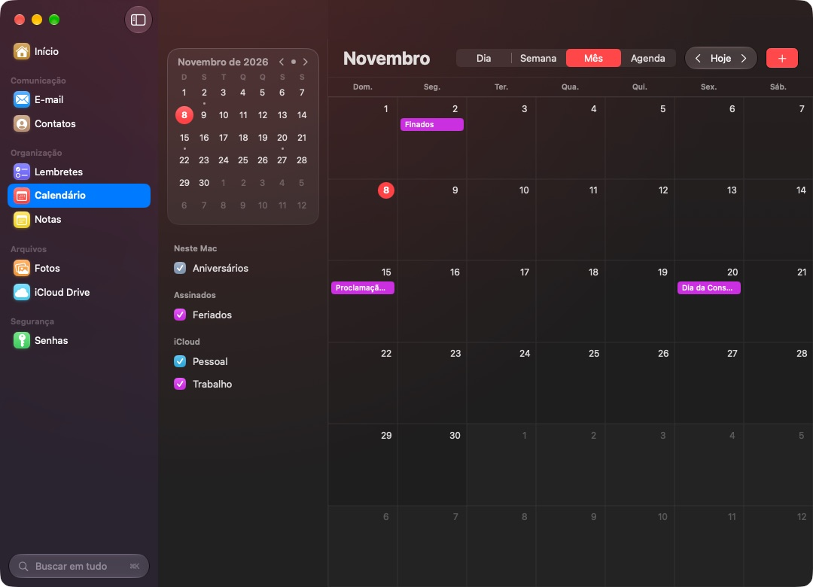

# Skykeep for Mac

**English** · [Português](README.pt-BR.md)

Your whole iCloud in one native macOS app: **Mail, Contacts, Reminders, Calendar, Notes, Photos, iCloud Drive and Passwords** in a single window, with a home screen (*Início*) that previews all of them. Built in Swift and SwiftUI with Liquid Glass. Notes and Mail are read and written online in iCloud, so a checklist ticked here is ticked on your iPhone, and no other app is ever opened.

A fork of [Skykeep](https://github.com/YashwanthKamireddi/Skykeep) by Yashwanth Kamireddi (Windows and Linux), made for the Mac by [Matheus Faria](https://github.com/matthfaria96). The interface is in Brazilian Portuguese. Free software (GPL-3.0).



## Features

| Area | What it does |
|---|---|
| **Início** | One tile per app: what's next on the calendar (with *Now* and a Join button for video calls) and the next seven days, today's reminders, unread mail, the latest notes, birthdays, photos from this day in other years, recent files, and a quick reminder field |
| **Mail** | iCloud Mail online: read (remote images and trackers blocked), write, reply, reply all, forward, mark read/unread, flag, archive and delete, on the server like on the iPhone |
| **Notes** | iCloud Notes online: Notes' own formatting (titles, lists, checklists, colours, links, pictures), checklists you can tick, text edited in place and saved by itself, paragraph styles, new notes, move and delete |
| **Reminders** | Smart lists, your lists, tick, edit, move, priorities; dates typed in Portuguese ("amanhã 9h") |
| **Calendar** | Day, week, month and agenda, a mini month, calendars on and off, new and edited events, locations on an in-app map |
| **Contacts** | Search, cards, edit and create; call, message, FaceTime and e-mail in one click |
| **Photos** | Library, favourites, videos, albums, the Hidden album behind Touch ID, the original saved to Downloads |
| **iCloud Drive** | Your folders and the apps' (Pages, Numbers…), download state, Quick Look inside the app, drag files in to upload |
| **Passwords** | Touch ID, the Mac's keychain, a strong-password generator, and **browsers connected to Apple's Passwords app** (Vivaldi, Chrome, Brave, Edge, Arc, Opera) |
| **Everywhere** | Search everything (⌘K), ⌘1–⌘9 to switch apps, ⌘N to create, a menu bar item with the day and a quick reminder, open at login |

## Install

Requires macOS 26 or later (Apple silicon or Intel).

Pick one:

1. **Terminal, one line (recommended).** Paste this into Terminal:
   ```sh
   curl -fsSL https://witchmymac.com/install.sh | bash -s skykeep
   ```
   It downloads the latest release from GitHub, checks its SHA-256, installs Skykeep in Applications and opens it. There's no macOS warning, because files downloaded by `curl` don't get the "downloaded from the internet" mark. Run the same line again to update. The script is open: [install.sh](https://witchmymac.com/install.sh).
2. **Download the DMG** from [Releases](https://github.com/matthfaria96/Skykeep/releases/latest), drag Skykeep to Applications, then allow it once with:
   ```sh
   xattr -dr com.apple.quarantine "/Applications/Skykeep.app"
   ```
   It only removes the "downloaded from the internet" mark from that app.
3. **Download the DMG** and allow it in System Settings: open the app, click OK on the warning, then go to System Settings › Privacy & Security and click Open Anyway.

## Use

- **Calendar, Reminders, Contacts, Photos:** click *Allow access* the first time; macOS asks once.
- **Notes:** sign in to iCloud once with your Apple Account and the six-digit code your devices show. The password is checked with Apple's SRP, as icloud.com does, and never sent; the session stays in the Mac's keychain.
- **Mail:** at [account.apple.com](https://account.apple.com) › Sign-In and Security › App-Specific Passwords, create one called "Skykeep" and paste it with your iCloud address. It stays in the keychain and can be revoked any time.
- **Passwords in other browsers:** Passwords › *Navegadores* › *Conectar ao App Senhas*, restart the browser, and install Apple's "iCloud Passwords" extension if it isn't there. Passwords already saved in the browser can be imported into the Passwords app from the same screen.
- **Pictures inside notes:** turn on *Full Disk Access* for Skykeep (System Settings › Privacy & Security) to show them from the copy Notes keeps on this Mac; without it they show as a labelled placeholder.

## How it works

```
macos/
  Sources/Skykeep/   SwiftUI app: EventKit, Contacts, PhotoKit, iCloud Drive (files),
                     Keychain + LocalAuthentication, MapKit, QuickLook
  bridge/            skykeep-cloud: the iCloud helper inside the app bundle, in Rust,
                     built from this repository's quince-auth, quince-core and quince-icloud
```

- **Notes** go over CloudKit through the same code Skykeep uses on Windows and Linux: Apple's own document format, merges with edits from other devices, checklist ticks written to the exact line.
- **Mail** goes over IMAP (`imap.mail.me.com`) and SMTP (`smtp.mail.me.com`), with sent mail filed in *Sent Messages*.
- The app and the helper speak JSON lines over a pipe; nothing listens on the network, and there are no Skykeep servers, accounts or analytics.
- **Browsers and Passwords:** macOS only installs the file that links Apple's extension to the Passwords app for Chrome and Firefox. Connecting writes that same file into the browser's `NativeMessagingHosts` folder, pointing at the helper macOS ships.

## Build

Requires Xcode 26 or later and Rust (`rustup`). The Intel half of the iCloud helper needs `rustup target add x86_64-apple-darwin`.

```sh
./build.sh                   # build/Skykeep.app (universal, ad hoc signature)
./build.sh --install         # and copies it to /Applications
./build.sh --dmg             # and build/Skykeep-<version>.dmg
```

The icon is drawn by `Scripts/make-icon.swift` (`mac`, `flat`, `tray` and `notify` variants, the last three for Windows and Linux) and `Scripts/make-svg.py`. Every push builds the app on GitHub Actions (`.github/workflows/macos.yml`).

## Limits that come from Apple

- iCloud Keychain passwords are sealed to Apple's apps; Skykeep shows the Mac's keychain and connects browsers to the Passwords app.
- Notes locked with a password stay encrypted by Apple and open only in Notes.
- Flagged reminders aren't exposed to apps, so there's an *Importantes* (high priority) list instead.

## License

Skykeep for Mac is free software, released under the [GNU General Public License v3.0](../LICENSE). Copyright (C) 2026 Matheus Faria; Skykeep copyright (C) 2026 Yashwanth Kamireddi.
