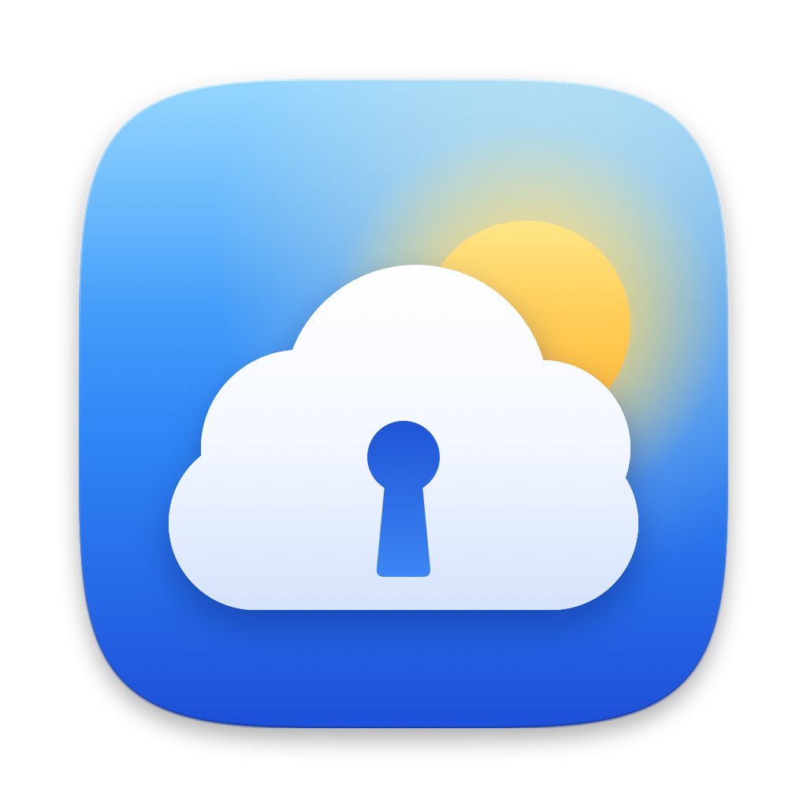
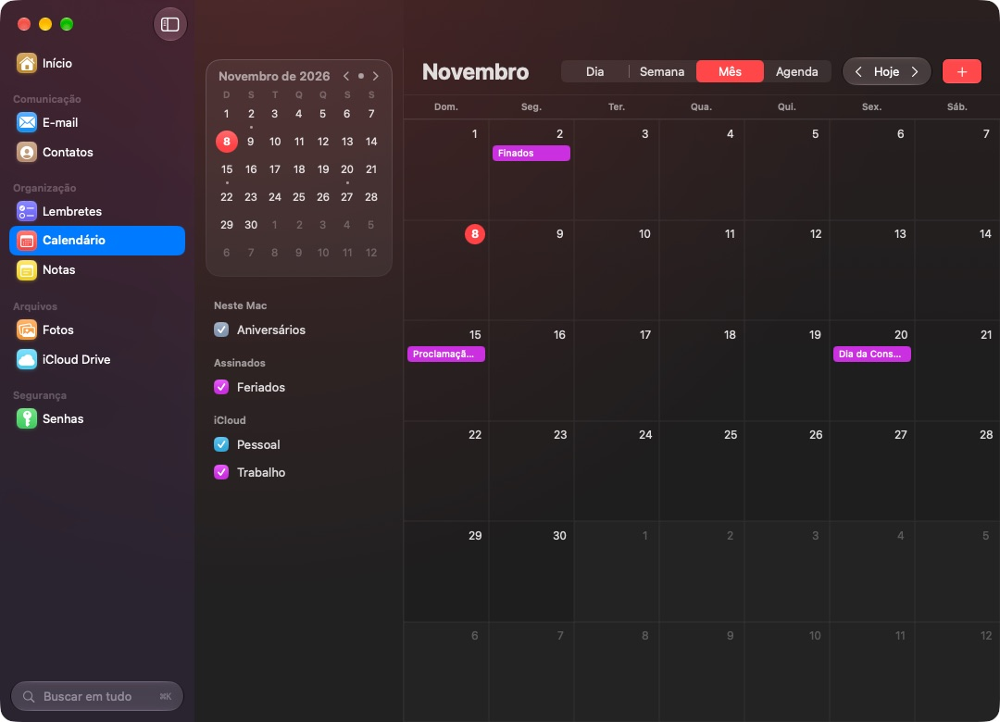

<p align="center">
  <a href="https://github.com/matthfaria96/Skykeep/releases/latest">
    
  </a>
</p>

<h1 align="center">Skykeep para Mac</h1>

<p align="center"><a href="README.md">English</a> · <b>Português</b></p>

<p align="center">
  <b>Todo o seu iCloud, numa janela só.</b><br>
  E-mail, Contatos, Lembretes, Calendário, Notas, Fotos, iCloud Drive e Senhas<br>
  num único app nativo, com uma tela de início que mostra o seu dia de relance.
</p>

<p align="center">
  
  
  
  
</p>

<p align="center">
  <a href="https://github.com/matthfaria96/Skykeep/releases/latest"><b>Baixar</b></a> ·
  <a href="#o-que-ele-faz">O que ele faz</a> ·
  <a href="#instalando-no-macos">Como instalar</a> ·
  <a href="#primeiros-passos">Primeiros passos</a> ·
  <a href="#perguntas-frequentes">Perguntas frequentes</a> ·
  <a href="#compilando">Compilando</a>
</p>

> [!NOTE]
> **Sem conta do Skykeep, sem servidores, sem anúncios, sem rastreio.** Seus dados vão só entre o
> seu Mac e a Apple. Grátis e de código aberto (GPL-3.0), parte do [witchmymac](https://witchmymac.com/).

<p align="center">
  
</p>

## O que ele faz

**Seu iCloud, sem abas.** O iCloud de nove apps num lugar só, abrindo na hora. Notas e E-mail são
lidos e gravados online no iCloud, então um item de checklist marcado aqui fica marcado no iPhone,
e nenhum outro app é aberto.

🏠 Início · ✉️ E-mail · 👤 Contatos · ✅ Lembretes · 📅 Calendário · 📝 Notas · 🖼️ Fotos ·
☁️ iCloud Drive · 🔑 Senhas · 🔎 Busca em tudo · 📍 Barra de menus

- **Seu dia de relance.** A tela de início mostra o próximo compromisso (com botão de entrar em reuniões), os lembretes de hoje, e-mails não lidos, as últimas notas, aniversários, fotos deste dia em outros anos e arquivos recentes.
- **Notas do jeito que nasceram.** Títulos, listas, cores, links, imagens e checklists clicáveis, editadas no lugar e salvas no iCloud sozinhas, em todos os aparelhos.
- **E-mail de verdade.** Ler, escrever, responder, encaminhar, sinalizar, arquivar e apagar, no servidor do iCloud, com imagens remotas e rastreadores bloqueados.
- **Os dados do próprio Mac.** Lembretes, Calendário, Contatos, Fotos e iCloud Drive direto do macOS, já sincronizados, com Visualização Rápida e mapas dentro do app.
- **Senhas em todo lugar.** Touch ID, gerador de senhas fortes, e Vivaldi, Chrome, Brave, Edge, Arc e Opera conectados ao app Senhas da Apple, nos dois sentidos.

<p align="center"><a href="https://github.com/matthfaria96/Skykeep/releases/latest"><b>Baixar o Skykeep</b></a> · <a href="https://github.com/matthfaria96/Skykeep/tree/main/macos">Código-fonte</a> · macOS 26 Tahoe ou mais novo</p>

## Instalando no macOS

**O jeito mais rápido: uma linha no Terminal.**

```sh
curl -fsSL https://witchmymac.com/install.sh | bash -s skykeep
```

Ele baixa a última versão do GitHub, confere o SHA-256, instala o Skykeep em Aplicativos e abre,
sem aviso do macOS (arquivos baixados pelo `curl` não ganham a marca de quarentena). Rode de novo
para atualizar. O script é aberto: [install.sh](https://witchmymac.com/install.sh).

**Ou à mão: três passos, trinta segundos.**

1. **Baixe o `.dmg`** na [última versão](https://github.com/matthfaria96/Skykeep/releases/latest).
2. **Arraste para Aplicativos.** Abra o `.dmg` e arraste o Skykeep para a pasta **Aplicativos**.
3. **Abra.** Na primeira vez, o macOS pede confirmação. Veja abaixo como liberar.

### Primeira abertura: o macOS vai bloquear o app. É normal.

O Skykeep é grátis e não passa pela App Store, então o macOS pede para você confirmar a origem uma
vez. Depois disso ele abre normalmente, para sempre.

| Passo | O que fazer |
|:---:|---|
| **1** | Abra o Skykeep. Aparece o aviso **"“Skykeep” Não Foi Aberto"**. Clique em **OK**. Nunca em *Mover para o Lixo*. |
| **2** | No menu Apple (canto superior esquerdo), abra **Ajustes do Sistema…** |
| **3** | Vá em **Privacidade e Segurança** e role até **Segurança**. Vai aparecer *"“Skykeep” foi bloqueado para proteger seu Mac"*. Clique em **Abrir Mesmo Assim**. |
| **4** | Confirme clicando em **Abrir Mesmo Assim** de novo e digite sua senha ou use o Touch ID. |
| **5** | Pronto! Daqui pra frente é só abrir por Aplicativos ou pelo Spotlight. |

> [!TIP]
> O site do witchmymac tem um [guia visual animado](https://witchmymac.com/#liberar) com cada uma dessas telas.

<details>
<summary><b>Prefere o Terminal?</b></summary>

Depois de arrastar o Skykeep para Aplicativos, tire a marca de quarentena:

```sh
xattr -dr com.apple.quarantine /Applications/Skykeep.app
```

</details>

> [!NOTE]
> **Por que isso acontece?** A Apple cobra US$ 99 por ano para "notarizar" apps. Como o Skykeep é
> grátis, o macOS pede para você confirmar a origem uma vez.

### Requisitos

| App | macOS mínimo | Processador |
|---|---|---|
| Skykeep para Mac | 26 Tahoe | Apple Silicon e Intel |

## Primeiros passos

| App | Na primeira vez |
|---|---|
| **Calendário, Lembretes, Contatos, Fotos** | Clique em **Permitir acesso**. O macOS pergunta uma vez só. |
| **Notas** | Entre no iCloud com sua conta Apple e o código de 6 dígitos que aparece nos seus aparelhos. Pedido uma vez; a sessão fica no Chaveiro do Mac. |
| **E-mail** | Em [account.apple.com](https://account.apple.com) › Entrar e Segurança › **Senhas de App**, crie uma chamada "Skykeep" e cole junto com seu endereço do iCloud. |
| **Senhas em outros navegadores** | Senhas › **Navegadores** › **Conectar ao App Senhas** e reinicie o navegador. Instale a extensão "Senhas do iCloud" da Apple se ainda não tiver. |
| **Imagens dentro das notas** | Opcional: ligue o **Acesso Total ao Disco** para o Skykeep em Ajustes do Sistema › Privacidade e Segurança. |

## Perguntas frequentes

<details>
<summary><b>A senha da minha conta Apple fica segura?</b></summary>

Ela não vai para lugar nenhum além da Apple. O login usa o protocolo SRP da própria Apple, com dois
fatores, do mesmo jeito que o icloud.com, então a senha em si nunca é enviada. A sessão fica no
Chaveiro do Mac. Não existem servidores nem contas do Skykeep.
</details>

<details>
<summary><b>Por que o E-mail pede uma senha de app?</b></summary>

É o jeito que a Apple oferece para apps de e-mail que não sejam o Mail acessarem o iCloud Mail
(IMAP e SMTP). Ela só serve para o e-mail, e você pode revogá-la quando quiser em account.apple.com.
</details>

<details>
<summary><b>Ele abre o Notas, o Mail ou outros apps sozinho?</b></summary>

Não. Notas e E-mail são lidos e gravados online no iCloud; mapas e pré-visualizações de arquivos
abrem dentro do Skykeep. Outro app só abre quando você pede: ligar para um contato, entrar numa
reunião por vídeo ou clicar num link.
</details>

<details>
<summary><b>Dá para marcar checklists e editar as notas?</b></summary>

Sim, como no Notas: marque um item de checklist, digite no lugar (salva sozinho um instante
depois), aplique título, lista ou checklist pelo menu de formato, crie, mova e apague notas. Notas
trancadas com senha continuam criptografadas pela Apple e só abrem no Notas.
</details>

<details>
<summary><b>Ele mostra as senhas do Chaveiro do iCloud?</b></summary>

A Apple lacra o Chaveiro do iCloud para os apps dela. O Skykeep mostra o Chaveiro do Mac, gera
senhas fortes e conecta seus outros navegadores ao app Senhas da Apple, para todos usarem as mesmas
senhas.
</details>

<details>
<summary><b>Tem versão para Windows ou Linux?</b></summary>

Sim: o próprio Skykeep, de Yashwanth Kamireddi, para Windows e Linux, no
[README principal](../README.md#install). O Skykeep para Mac usa o mesmo código em Rust para o iCloud.
</details>

<details>
<summary><b>Achei um bug ou tenho uma ideia.</b></summary>

Abra uma [issue](https://github.com/matthfaria96/Skykeep/issues). Toda sugestão é bem-vinda.
</details>

## Compilando

Requer Xcode 26 ou mais novo e Rust (`rustup`). A metade Intel do componente do iCloud precisa de
`rustup target add x86_64-apple-darwin`.

```sh
./build.sh                   # build/Skykeep.app (universal, assinatura ad hoc)
./build.sh --install         # e copia para /Applications
./build.sh --dmg             # e build/Skykeep-<versão>.dmg
```

```
macos/
  Sources/Skykeep/   app SwiftUI: EventKit, Contacts, PhotoKit, iCloud Drive, Chaveiro,
                     LocalAuthentication, MapKit, Visualização Rápida
  bridge/            skykeep-cloud, o componente do iCloud dentro do app, em Rust, feito com os
                     crates quince-auth, quince-core e quince-icloud deste repositório:
                     Notas pelo CloudKit, E-mail por IMAP e SMTP
  Scripts/           o ícone (make-icon.swift, make-svg.py), para macOS, Windows e Linux
```

Cada envio compila o app e o `.dmg` no GitHub Actions ([macos.yml](../.github/workflows/macos.yml)).

## Créditos e licença

O Skykeep para Mac é feito por [Matheus Faria](https://github.com/matthfaria96), num fork do
[Skykeep](https://github.com/YashwanthKamireddi/Skykeep) de Yashwanth Kamireddi, cujo código do
iCloud ele usa. Software livre sob a [GNU General Public License v3.0](../LICENSE).
Copyright (C) 2026 Matheus Faria; Skykeep copyright (C) 2026 Yashwanth Kamireddi. Sem vínculo com
a Apple Inc.
